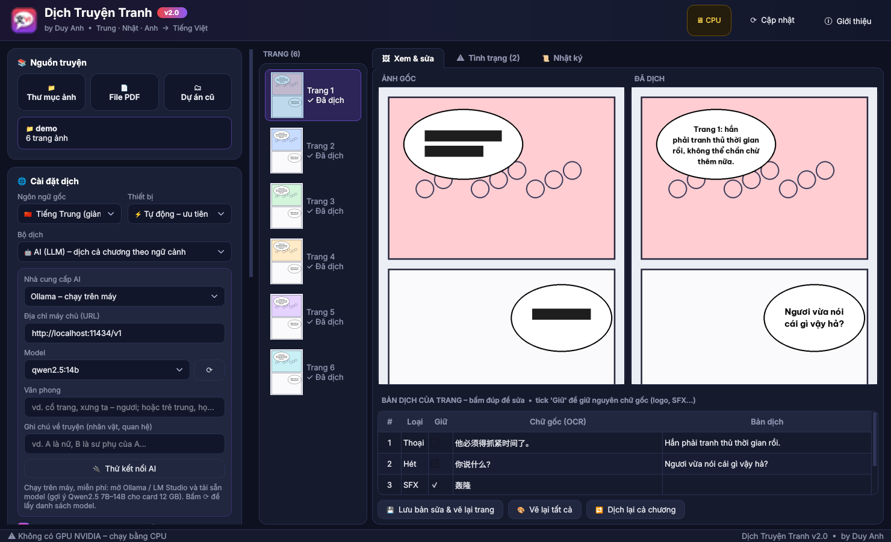

  

<h1 align="center">Dịch Truyện Tranh v2.2</h1>

<b>by Duy Anh</b> — Dịch truyện tranh <b>Trung · Nhật · Hàn · Anh → Tiếng Việt</b> ngay trên máy, chạy GPU

  
  
  

App tự **nhận dạng chữ** trong khung thoại, **dịch** (máy dịch chạy GPU, Google, hoặc **AI dịch cả chương theo ngữ cảnh**), **xoá chữ gốc bằng AI** và **vẽ chữ Việt vừa khít bóng thoại**. Nguồn là thư mục ảnh (đánh số trang), file PDF hoặc truyện nén CBZ/ZIP – kéo thả vào cửa sổ là xong, kéo nhiều chương thì dịch lần lượt cả hàng đợi.

## ⬇️ Tải về (bản Portable – không cần cài đặt)

Vào **[Releases](https://github.com/laocuumon1982-cpu/DichManga/releases/latest)** và chọn:

| Bản | File | Dùng cho |
|---|---|---|
| **GPU** (khuyên dùng) | `DichTruyenTranh_v2.1_Portable_GPU.7z.001`, `.002`… | Card NVIDIA **GTX 16xx / RTX 20xx trở lên** – nhanh nhất |
| **CPU** | `DichTruyenTranh_v2.1_Portable_CPU.zip` | Máy không có card NVIDIA |

**Bản GPU** được chia nhiều phần (GitHub giới hạn 2 GB/file): tải **tất cả** các phần `.7z.001`, `.7z.002`… vào cùng một thư mục, rồi dùng [7-Zip](https://www.7-zip.org/) bấm chuột phải vào file **`.7z.001`** → *Extract Here*.

Sau đó mở **`DichTruyenTranh.exe`**. Lần dịch đầu tiên app tự tải model (cần Internet), lưu trong thư mục `models\` – chép cả thư mục sang USB / máy khác vẫn chạy được.

> Nếu app không mở: cài [Microsoft Visual C++ Redistributable x64](https://aka.ms/vs/17/release/vc_redist.x64.exe), hoặc chạy `Chay_xem_loi.bat` để xem lỗi.

### 🔄 Cập nhật
Bấm nút **⟳ Cập nhật** ở góc trên app. App tự kiểm tra bản mới trên GitHub; khi có bản mới, nút đổi thành **⬆ Có bản mới** – bấm để tải gói cập nhật nhỏ (vài trăm KB) và khởi động lại, không cần tải lại cả bản portable.

## ✨ Tính năng
- **Kéo thả** thư mục ảnh / file PDF / CBZ / dự án cũ vào cửa sổ; **🆕 dịch nhiều chương một lượt** (hàng đợi).
- **OCR trên GPU**: EasyOCR (Trung, Hàn, Anh), manga-ocr (Nhật, đọc tốt chữ dọc). Chọn thứ tự đọc ô thoại (phải → trái / trái → phải). Ảnh webtoon dài tự cắt đoạn.
- **Bộ dịch**:
  | Ngôn ngữ | Bộ dịch |
  |---|---|
  | Trung | **HachimiMT-60** (mặc định), HachimiMT-30, HachimiMT-60-QT (giọng convert ta/ngươi/hắn), NLLB-200 |
  | Nhật | **NLLB-200 600M** (mặc định), Opus-MT ja→vi |
  | Hàn (manhwa) | **NLLB-200 600M** (mặc định), GTX Google |
  | Anh | **GTX Google** |
  | Tất cả | **🤖 AI (LLM)** – dịch cả chương theo ngữ cảnh · GTX Google (online, miễn phí, dịch bù câu bị bỏ trống) |
- **🆕 AI dịch cả chương theo ngữ cảnh** (v2.1): gom chữ mọi trang rồi gửi một lượt cho AI, kèm **bảng thuật ngữ**, **văn phong** và **ghi chú truyện** → tên riêng, xưng hô thống nhất cả chương.
  - **Chạy trên máy, miễn phí**: [Ollama](https://ollama.com) hoặc [LM Studio](https://lmstudio.ai) (gợi ý Qwen2.5 7B–14B cho card 12 GB) – không gửi truyện ra ngoài. Với Ollama app **tự mở Ollama, tự chọn model đã cài**, chưa có model thì bấm **⬇ Tải model** ngay trong app.
  - **Online** (API key của bạn): DeepSeek, Google Gemini, OpenAI, Anthropic Claude, hoặc máy chủ kiểu OpenAI khác.
  - Nút **⟳** lấy danh sách model, **🔌 Thử kết nối AI**; câu AI bỏ sót tự hỏi lại rồi GTX dịch bù.
- **🆕 Bảng thuật ngữ** (📖 Thuật ngữ): tên riêng / xưng hô cố định cho AI; dòng có chữ gốc là tiếng Việt thì **tự sửa sau khi dịch** với mọi bộ dịch. Nhập / xuất CSV.
- **🆕 👥 Xưng hô nhân vật** (F6): từng cặp A ↔ B (xưng gì, gọi nhau là gì), có mẫu sẵn; **✨ mẫu văn phong** theo thể loại.
- **🆕 📥 Kịch bản**: xuất `.tsv` / `.txt`, **nhập kịch bản** từ Excel / TSV / CSV / TXT / Word / JSON để lồng chữ bản dịch làm sẵn. Chế độ **Chỉ xoá chữ** cho bản RAW sạch.
- **🆕 ☑ Soát lỗi cả chương** (F7) 10 loại lỗi + **🪄 tự sửa dấu câu**; **🔍 Tìm & thay thế** cả chương (Ctrl+H).
- **🆕 🏷 Logo nhóm dịch** tự đặt vào góc trống; **📜 cắt / ghép webtoon** không cắt ngang bóng thoại (F12).
- **🔁 Dịch lại cả chương**: sửa thuật ngữ hoặc đổi bộ dịch rồi dịch lại – không phải đọc chữ / xoá chữ lại.
- **🆕 Xoá chữ bằng AI (LaMa cho manga)**: chữ nằm trên hình / nền lưới chấm được vẽ lại nền sạch (không còn vết nhoè). Bóng thoại nền phẳng vẫn tô thẳng màu nền.
- **Vẽ chữ vừa bóng thoại**: lấy đúng hình lòng bóng (tròn, elip, dọc, có đuôi, viền hở, nền lưới chấm), chữ chia đều các dòng, chỉnh được **cỡ chữ tối đa**.
- **🆕 Nhận diện loại ô**: thoại, suy nghĩ, hét (tự IN HOA), dẫn truyện, chữ trên hình, SFX. Tick **Giữ** để giữ nguyên chữ gốc (logo, tiêu đề, SFX…).
- **🆕 15 font tiếng Việt** kèm sẵn (Google Fonts, OFL) có xem trước; tự cảnh báo font **thiếu dấu**.
- **3 công đoạn chạy song song** (đọc chữ → dịch → vẽ), hiển thị **% tiến độ, giây/trang, thời gian còn lại**.
- Xem **gốc / đã dịch cạnh nhau** (cuộn đồng bộ), **sửa bản dịch** trong bảng rồi vẽ lại, đổi font / cỡ chữ / IN HOA và **vẽ lại tất cả** không cần dịch lại.
- Xuất ảnh JPG/PNG, **gộp PDF**, **🆕 CBZ**, `ban_dich.txt`, kịch bản, **🆕 Excel lời thoại**, **🆕 PSD 3 lớp** (gốc / nền sạch / chữ dịch – sửa tiếp trong Photoshop).

## ⚙️ Cài đặt & dữ liệu
- `config.json` – mọi cài đặt (sửa tay được; bản cũ tự nhập từ registry lần đầu). API key AI lưu ở đây, **chỉ trên máy bạn**, không ghi vào dự án.
- `data.db` – bảng thuật ngữ và bảng xưng hô (SQLite).
- Bản portable: hai file trên nằm cạnh `DichTruyenTranh.exe`, cùng thư mục `models\` – chép cả thư mục đi là giữ nguyên.

## 🛠 Chạy từ mã nguồn
1. Cài **Python 3.11 hoặc 3.12** (tick *Add python.exe to PATH*), cập nhật driver NVIDIA.
2. Chạy `install.bat` – tự nhận card và cài PyTorch phù hợp (RTX → CUDA 12.8, GTX 9xx/10xx → CUDA 12.6, không có NVIDIA → CPU). Tạo lối tắt **Dich Truyen Tranh** ngoài Desktop.
3. Mở bằng lối tắt hoặc `run.bat`.

Tự tạo bản portable trên máy: `build_portable.bat` (tự nhận GPU, hỏi tải sẵn model) – kết quả ở `dist\`.

## 📁 Kết quả
- `0001.jpg, 0002.jpg …` – các trang đã dịch
- `<tên truyện>_vi.pdf` – PDF gộp
- `ban_dich.txt` – chữ gốc + bản dịch theo trang
- `<tên truyện>_kich_ban.tsv`, `_kich_ban.txt` – kịch bản (sửa xong nhập lại được)
- `<tên truyện>_vi.cbz` – truyện nén (nếu bật)
- `<tên truyện>_loi_thoai.xlsx` – bảng lời thoại (trang, ô, loại, gốc, dịch, ghi chú)
- `psd\0001.psd …` – PSD 3 lớp (nếu bật)
- `_work\project.json` – mở lại bằng **Dự án cũ** để sửa tiếp

## ⚠️ Giới hạn
- Chữ hiệu ứng (SFX) vẽ tay, chữ nghiêng mạnh có thể bị bỏ sót / đọc sai – sửa tay trong bảng.
- GTX là endpoint không chính thức của Google, có thể bị chặn tạm thời khi dịch rất nhiều trang liên tục.

## 🙏 Cảm ơn
[AnimeMangaInpainting / LaMa](https://github.com/Sanster/models/releases/tag/AnimeMangaInpainting) (MIT) · [Google Fonts](https://github.com/google/fonts) (OFL) · [HachimiMT](https://huggingface.co/ngocdang83) (ngocdang83, CC-BY-4.0) · [NLLB-200](https://huggingface.co/facebook/nllb-200-distilled-600M) (Meta) · [Opus-MT](https://huggingface.co/Helsinki-NLP/opus-mt-ja-vi) · [EasyOCR](https://github.com/JaidedAI/EasyOCR) · [manga-ocr](https://github.com/kha-white/manga-ocr) · [PyMuPDF](https://pymupdf.readthedocs.io/) · [PySide6](https://doc.qt.io/qtforpython-6/)

Một số ý tưởng ở v2.1 (dịch cả chương bằng AI, bảng thuật ngữ, xoá chữ LaMa, nhận diện loại bóng, tab Tình trạng, xuất PSD/Excel) tham khảo từ [MangaForge](https://github.com/PhamTienThang2510/MangaForge) – tự viết lại, không dùng mã nguồn (MangaForge theo giấy phép GPL-3.0). Giấy phép bên thứ ba: [THIRD_PARTY_NOTICES.md](THIRD_PARTY_NOTICES.md).
